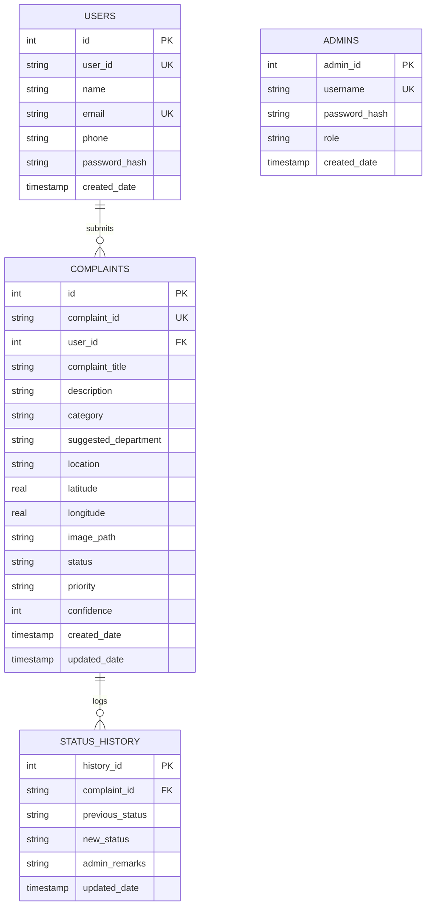

# CiviNexa AI: AI-Powered Civic Issue Reporting & Tracking System

[](https://python.org)
[](https://flask.palletsprojects.com/)
[](https://sqlite.org/)
[](https://getbootstrap.com/)
[](https://leafletjs.com/)
[](#)

> **CiviNexa AI** is a modern, responsive, full-stack civic governance platform designed to empower citizens to report public infrastructure and municipal issues. The platform leverages natural language processing and weighted semantic classification to automatically identify complaint categories, estimate urgency, and route grievances directly to the responsible municipal departments.

---

## 📌 Table of Contents

1. [Key Features](#-key-features)
2. [Demonstration Credentials](#-demonstration-credentials)
3. [Technology Stack](#-technology-stack)
4. [AI Classification Engine](#-ai-classification-engine)
5. [Database Architecture](#-database-architecture)
6. [Folder Structure](#-folder-structure)
7. [Installation & Setup](#-installation--setup)
8. [Running in Visual Studio Code](#-running-in-visual-studio-code)
9. [Automated Testing](#-automated-testing)
10. [Security Implementations](#-security-implementations)
11. [Evaluation Walkthrough](#-evaluation-walkthrough)

---

## 🌟 Key Features

### 👤 Citizen Module
- **User Registration & Authentication**: Secure account creation with SHA-256 password hashing.
- **Citizen Dashboard**: Personal command center showing counters for *Total Submitted*, *Under Review*, *In Progress*, and *Resolved* grievances.
- **Smart Issue Reporting Form**:
  - Live AI-powered category and department recommendation as the citizen types.
  - Interactive **Leaflet.js & OpenStreetMap** map to pinpoint coordinates with draggable markers.
  - **"Use Current GPS Location"** one-click geolocation button.
  - High-resolution photographic evidence upload with instant client-side preview.
- **Unique Complaint ID Generation**: Generates official tracking IDs (e.g., `CNX-2026-1001`).
- **Real-Time Complaint Tracking**:
  - Open tracking page by unique ID without requiring login.
  - Detailed metadata (Category, Department, Date, Coordinates, Attached Photo).
  - Chronological vertical timeline with status badges and municipal inspection remarks.
  - Printable grievance receipt functionality.

### 🛡️ Administrator Module
- **Protected Admin Portal**: Dedicated access control via `@admin_required` decorators.
- **Executive Analytics Dashboard**:
  - Aggregated KPI cards (*Total Complaints*, *New Submitted*, *Under Review*, *In Progress*, *Resolved*, *Rejected*).
  - Interactive **Chart.js** visualizations:
    - **Category Volume Bar Chart**: Distribution of issues across civic departments.
    - **Lifecycle Doughnut Chart**: Proportional breakdown of issue statuses.
  - Real-time recent complaints stream.
- **Complaints Management Suite**:
  - Advanced search across ID, title, citizen name, and location.
  - Dynamic status and category dropdown filters.
  - Modal status updater with mandatory administrator inspection remarks.
  - Automated timestamped logging in the `status_history` audit table.

---

## 🔑 Demonstration Credentials

The application comes pre-seeded with sample data and ready-to-use accounts for evaluation:

| Portal | Role | Username / Email | Password | Access URL |
| :--- | :--- | :--- | :--- | :--- |
| **Admin Portal** | Chief Administrator | `admin` | `admin123` | `http://127.0.0.1:5000/admin/login` |
| **Citizen Portal** | Registered Citizen | `rahul.citizen@civinexa.org` | `citizen123` | `http://127.0.0.1:5000/login` |

> 💡 **Quick Fill Buttons**: Both login pages include a single-click button to automatically populate these credentials during demonstrations.

---

## 💻 Technology Stack

### Frontend
- **HTML5 & CSS3**: Modern UI with CSS variables, gradient accents, and responsive layout.
- **Bootstrap 5.3.3**: Grid layout, responsive navigation, modals, and alerts.
- **Bootstrap Icons 1.11.3**: Clean vector icons for civic categories and controls.
- **Leaflet.js (v1.9.4)**: Interactive mapping with OpenStreetMap tiles and reverse geocoding.
- **Chart.js (v4.4.1)**: Interactive canvas-based data visualizations.
- **Vanilla JavaScript**: Debounced AI API calls, image upload preview, live client-side filtering.

### Backend
- **Python 3.12+**: Core server execution environment.
- **Flask 3.x**: Lightweight WSGI web application framework.
- **Werkzeug 3.x**: Cryptographic password hashing (`generate_password_hash`) and secure file handling (`secure_filename`).
- **Python-Dotenv**: Environment configuration management.

### Database
- **SQLite 3**: Embedded relational database with foreign key support, ACID compliance, and zero external setup.

---

## 🧠 AI Classification Engine (`classifier.py`)

The classification module analyzes complaint descriptions and titles using weighted semantic matching and keyword extraction:

| Civic Category | Responsible Municipal Department | Sample Trigger Keywords | Urgency Triggers |
| :--- | :--- | :--- | :--- |
| **Road Maintenance** | Dept. of Roads & Infrastructure / PWD | *pothole, asphalt, crater, cave-in, pavement, uneven road* | *sinkhole, fatal, cave-in* |
| **Waste Management** | Municipal Solid Waste & Sanitation Dept. | *garbage, trash, waste, dump, overflowing bin, stench, litter* | *carcass, hospital waste, toxic* |
| **Drainage & Sewage** | Sewage, Stormwater & Drainage Board | *drain, sewage, gutter, open manhole, waterlogging, flooding* | *open manhole, sewage in homes* |
| **Electricity & Lighting** | City Electricity Board & Public Lighting Authority | *streetlight, dark, unlit, sparking, loose wire, blackout, transformer* | *live wire, sparking, electric shock* |
| **Water Supply** | Public Water Supply Board (Jal Board) | *pipeline burst, water leak, dirty water, low pressure, no water* | *pipe burst, contaminated water* |
| **Public Infrastructure** | Urban Development & Civic Infrastructure Directorate | *broken bench, playground swing, bus shelter, railing, footbridge* | *footbridge collapse, broken railing* |

### Fallback Mechanism:
If the text is vague, ambiguous, or irrelevant (e.g., *"Hello I need tax receipt"*), the engine safely flags the grievance as **"Needs Manual Review"** and routes it to the *General Grievance Redressal & Triage Cell*.

---

## 🗄️ Database Architecture

The SQLite database (`database/civinexa.db`) is automatically initialized upon startup with the following tables:



---

## 📁 Folder Structure

```
CiviNexa/
├── app.py                     # Main Flask application controller & route handlers
├── database.py                # Database connection, schema creation & sample data seeder
├── classifier.py              # AI keyword-weighted classification engine
├── test_app.py                # Automated Pytest suite covering all 12 test specifications
├── requirements.txt           # Python library dependencies
├── README.md                  # Detailed documentation and demonstration manual
├── database/
│   └── civinexa.db            # SQLite database file (auto-generated)
├── uploads/                   # Uploaded photographic evidence storage
├── templates/
│   ├── base.html              # Master layout with responsive navbar, flash alerts & footer
│   ├── index.html             # Landing page with hero, live counters, categories & preview
│   ├── about.html             # System architecture, mission, and technology breakdown
│   ├── register.html          # Citizen registration portal
│   ├── login.html             # Citizen authentication portal
│   ├── dashboard.html         # Citizen dashboard & grievance management table
│   ├── report.html            # Report page with Leaflet map & AI live assistant
│   ├── track.html             # Tracking page with timeline & OpenStreetMap pin
│   ├── admin_login.html       # Administrator portal login
│   ├── admin_dashboard.html   # Admin executive dashboard with Chart.js analytics
│   ├── complaints.html        # Comprehensive complaints management & status updater
│   └── contact.html           # Help desk, emergency helplines & FAQ accordion
└── static/
    ├── css/
    │   └── style.css          # Custom styling (modern blue, white, and violet design)
    ├── js/
    │   └── script.js          # Leaflet maps, debounced AI classifier, and search filters
    └── images/                # Static assets and graphics
```

---

## 🚀 Installation & Setup

### Prerequisites
- Python 3.10, 3.11, or 3.12 installed on your machine.
- Pip (Python Package Manager).

### Step 1: Clone or Open Project Directory
Clone the repository and open the project directory:
```bash
git clone https://github.com/dharshan-my/Civinexa.git
cd Civinexa
```

### Step 2: Create a Python Virtual Environment (Optional but Recommended)
```bash
python -m venv venv
# On Windows PowerShell:
.\venv\Scripts\Activate.ps1
```

### Step 3: Install Required Dependencies
```bash
pip install -r requirements.txt
```

### Step 4: Run the Application
```bash
python app.py
```

Open your browser and navigate to:
👉 **`http://127.0.0.1:5000`**

---

## 💻 Running in Visual Studio Code

1. Launch **Visual Studio Code**.
2. Go to **File** &rarr; **Open Folder...** and select the `Civinexa` folder.
3. Open a new integrated terminal by pressing <kbd>Ctrl</kbd> + <kbd>`</kbd> (backtick) or going to **Terminal** &rarr; **New Terminal**.
4. Ensure the Python interpreter is selected:
   - Press <kbd>Ctrl</kbd> + <kbd>Shift</kbd> + <kbd>P</kbd>.
   - Type `Python: Select Interpreter`.
   - Select your Python 3.12 installation.
5. In the terminal, run:
   ```bash
   python app.py
   ```
6. Click on the URL `http://127.0.0.1:5000` displayed in the terminal output to preview the application.

---

## 🧪 Automated Testing

A dedicated test suite `test_app.py` is included to verify all functional requirements:

```bash
pytest test_app.py -v
```

### Test Coverage Highlights:
- ✅ **AI Classification**: Accurately categorizes all 6 civic categories and defaults to manual review on vague inputs.
- ✅ **Citizen Registration & Login**: Hashed password persistence, duplicate email prevention, invalid credentials rejection.
- ✅ **Complaint Submission**: Validates title, description, Leaflet coordinate capture, and photo upload.
- ✅ **Unique ID Generation**: Validates `CNX-YYYY-XXXX` format uniqueness.
- ✅ **Complaint Tracking**: Retrieves chronological status history and admin remarks.
- ✅ **Admin Access Control**: Blocks unauthorized visitors from accessing `/admin/dashboard` and `/admin/complaints`.
- ✅ **Admin Status Updates**: Changes status (`In Progress`, `Resolved`) and logs remarks to timeline.

---

## 🔒 Security Implementations

1. **Password Hashing**: Passwords are never stored in plaintext. They are encrypted using Werkzeug's PBKDF2 with SHA-256 salts.
2. **Session Authentication**: Server-side session authentication prevents unauthorized privilege escalation.
3. **Route Protection**: Dedicated custom decorators (`@login_required` and `@admin_required`) protect sensitive operations.
4. **Parameterized SQL Queries**: All database interactions use parameterized placeholders (`?`) to prevent SQL Injection attacks.
5. **Safe File Uploads**:
   - Allowed extensions restricted to `{"png", "jpg", "jpeg", "webp"}`.
   - File names sanitized via `secure_filename()` with timestamp prefixes to prevent file overwrites.
   - Request body limit capped at 16MB (`MAX_CONTENT_LENGTH`).
6. **Input Validation**: Server-side validation checks title, description, and location validity before database commit.

---

## 🎬 Evaluation Walkthrough

Follow this 5-minute walkthrough during your project demonstration:

1. **Homepage (`/`)**:
   - Show the modern hero banner, live statistics counter, and supported civic categories.
2. **Citizen Registration & Login (`/register`, `/login`)**:
   - Click *"Fill Demo Citizen Credentials"* &rarr; Sign in as **Rahul Sharma**.
3. **Citizen Dashboard (`/dashboard`)**:
   - View previously submitted complaints, status badges, and quick summary metrics.
4. **Report a Grievance (`/report`)**:
   - Enter title: *"Dangerous road pothole near bus terminal"*.
   - Start typing in the description: *"There is a deep crater and broken asphalt causing vehicles to skid"*.
   - **Point out the live AI box**: Watch the system detect **"Road Maintenance"**, recommend **Department of Roads & Infrastructure (PWD)**, and assign **High** priority!
   - Click *"Apply AI Suggestion"*.
   - Click the interactive Leaflet map to drop a pin, or click *"Use GPS Location"*.
   - Attach a sample photo and click *"Submit Complaint"*.
5. **Live Complaint Tracking (`/track`)**:
   - Show the newly generated Tracking ID (e.g., `CNX-2026-XXXX`).
   - Demonstrate the interactive map pin, metadata box, and the chronological timeline.
6. **Administrator Command Center (`/admin/login`, `/admin/dashboard`)**:
   - Log in as `admin` / `admin123`.
   - Show the KPI cards and interactive **Chart.js** bar & doughnut analytics.
7. **Complaint Management (`/admin/complaints`)**:
   - Use the live search bar to filter complaints.
   - Click *"Update"* on any complaint, change status to **"In Progress"** or **"Resolved"**, enter inspector notes: *"Patchwork completed with hot-mix asphalt"*.
   - Go back to the tracking page for that complaint and verify the updated status and remarks appear on the timeline with exact timestamps!

---

## 📜 Academic Declaration

- **Project Title**: AI-Powered Civic Issue Reporting and Tracking System (CiviNexa AI)
- **Degree Course**: Bachelor of Computer Applications (BCA) - Final Year Capstone Project
- **Architecture**: Modular Full-Stack Web Application (Flask, SQLite, NLP Classifier, Leaflet.js, Bootstrap 5)
